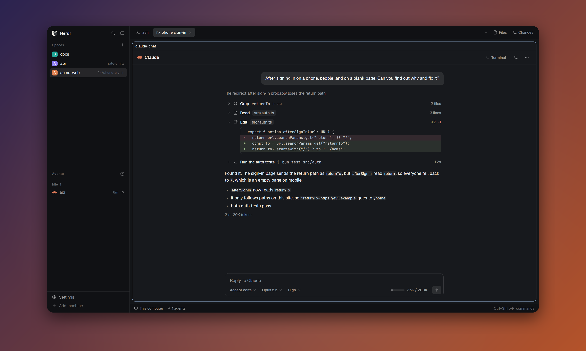

# Claude chat for Herdr

A [Herdr](https://herdr.dev) mod that opens every Claude Code session as a native chat pane, with Alt+T to flip to the real terminal.



## Install

Ask your agent in Herdr to add the mod from this repo; [RECIPE.md](RECIPE.md) tells it what to do. By hand:

```sh
git clone https://github.com/quanticstudios/herdr-claude-chat
cp -R herdr-claude-chat/mods/claude-chat ~/.config/herdr-app/mods/
python3 ~/.config/herdr-app/mods/claude-chat/bin/install-hook.py
```

Then add `"alt-t": "claude-chat.toggle"` to the `global` section of `~/.config/herdr-app/keys.json` and start a new Claude session in a Herdr terminal.

The hook installer adds two SessionStart hooks to `~/.claude/settings.json`. Remove them with `install-hook.py --uninstall`.

It reads `~/.claude` and the Claude Code binary, runs `python3`, `hc`, `git` and a few shell tools, and makes no network requests. Streaming and the slash menu read Claude Code's screen and binary, so a Claude Code update can break them. Built against Claude Code 2.1.329.

## Credits

The approval card, held follow-ups and the syntax colors follow ideas from [ChmaraX/herdr-chat](https://github.com/ChmaraX/herdr-chat) (MIT), rebuilt for this mod.

## License

MIT. Geist is under the SIL Open Font License and Lucide icons under ISC; their licenses are in `mods/claude-chat/fonts` and `mods/claude-chat/icons`.
