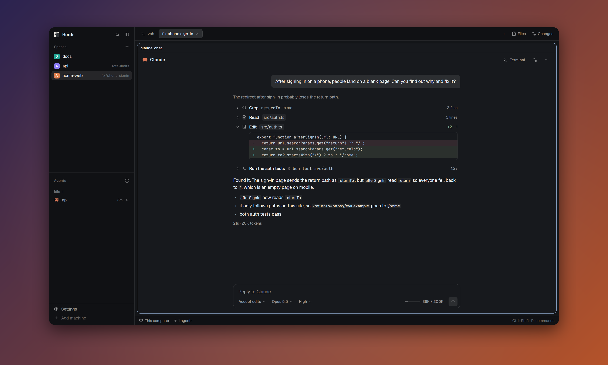

# Claude chat

Every Claude Code session you start in a Herdr terminal opens as a native chat pane. The chat shows the conversation as messages, tool rows and Markdown, streams Claude's reply as it is written, and gives you a composer with slash commands, file mentions, images, and model, effort and permission-mode pickers. Claude Code keeps running in its own terminal underneath. Alt+T flips between the chat and the real TUI.

## What you see

The chat fills the pane Claude's terminal was in. Top to bottom:

- **Header**, 44px, bottom border. The Claude mark (16px), the session title (Claude's terminal title, else the tab name, 14px semibold), the git branch with a branch icon (12px, muted), and a status pill while Claude works or waits. On the right: a **Terminal** button, a **Changes** button when the layout has a Changes panel, and a `…` menu (Terminal view, Show files, Copy folder path, Close chat and keep terminal).
- **Transcript**, centered in a 760px column, Geist 14px with 1.55 line height, code in JetBrains Mono 12.5px. Your messages are right-aligned bubbles with image thumbnails and folded pasted text. Claude's replies are plain Markdown: lists, tables, code blocks with a copy button, links. Each tool call is one 28px row with an icon, the tool name, its main argument as a chip (file path, command, URL, pattern) and a result summary on the right ("2 files", "3 lines", "+1 −1", "1.2s", red error text). Rows expand to show the diff, output or image. Short thinking (up to 400 characters, one paragraph) shows as a muted line, as Claude Code's own "· summary" lines do; longer thinking is a "Thought for 4s ›" row that expands; thinking with no text is hidden. Notices sit between messages: "Conversation compacted", "Switched to Sonnet 5.5", "※ Recap" rows with Claude Code's session recaps (muted italic), API errors and usage limits as cards. Each finished turn ends with its time and token count in muted 12px.
- **Working row**, above the composer while Claude works: a spinner, Claude's own verb ("Whirlpooling…", "Writing…") and the elapsed time and tokens in muted text. A live plan card ("Checking the page, 2 of 3") shows above it when Claude keeps a todo list.
- **Queued messages**, one chip each, when you send while Claude works. The first chip has **Send now**, which interrupts Claude so the queued message starts at once; the chip then reads "Sending…" in the accent color.
- **Composer**, a rounded box in the same 760px column. A textarea ("Reply to Claude"), then a row of chips: permission mode (Default, Accept edits, Plan, Auto, Bypass permissions, as your settings allow), model and effort, a context meter once Claude reports how full its context is, and a send button that turns into a stop button while Claude works.
- **Approval card**, in place of the composer when Claude asks for permission or asks a question: the question, the command or diff, and one button per option with its key.

All colors come from the Herdr theme, so light and dark both work.

## How it behaves

- **Starting.** When Claude Code starts in a Herdr terminal, a SessionStart hook splits that pane, puts the chat above, zooms it and focuses the composer. Claude's terminal stays at full height behind it, because the streaming reads Claude's screen.
- **Working.** The status pill and working row show, and the reply streams in smoothly at about 30 frames a second instead of in screen-sized chunks. Tool rows appear as Claude calls them, with a spinner until each finishes.
- **Blocked.** The approval card replaces the composer and takes the keyboard. Picking an option presses that key in Claude's terminal. Typing a message while blocked keeps it as a draft and says "Answer Claude's question first".
- **Done and idle.** The working row goes away, the turn's time and tokens appear, and the composer is ready.
- **Sending.** Enter sends, Shift+Enter adds a line. The text goes to Claude's terminal as typed input. A failed send puts the draft back. Up and Down in an empty box walk your sent history. Drafts survive a reload.
- **`/` menu.** Lists Claude Code's built-in commands with their aliases (`/remote-control (rc)`), your personal and project commands and skills, and every enabled plugin's skills and commands as `plugin:name`. Fuzzy matching; Up, Down and Tab move, Enter picks. The list scrolls with the selection.
- **`@` menu.** Files in the folder (git's file list, else a 4-level `find`).
- **Images.** Paste from the clipboard or drop files on the composer; they show as thumbnails you can remove.
- **Pickers.** Mode, model and effort chips send the matching Claude command (`/model`, `/effort`, Shift+Tab for the mode).
- **Alt+T** toggles between the chat and Claude's terminal. A plain shell split next to the chat still gets its own Alt+T.
- **Scrolling.** The transcript follows the bottom while you are there; scrolling up stops it and shows a jump-to-bottom button. Older turns load as you scroll up.

## Built from

- `mods/claude-chat/`, a gpui-kit mod (`mod.json`: `place: "none"`, focusable). `main.js` is the view. `chat.js` finds and drives the terminal, `composer.js` the composer, `header.js` the header. `model.js` turns transcript lines into chat items (`items.d.ts`). `source.js` reads the transcript and the live screen. `md.js`, `mdparse.js` and `mdcode.js` render Markdown. `tools.js` and `toolview.js` draw tool rows. `system.js` and `sys.js` draw notices, thinking and plans. `theme.js` holds the type and spacing tokens.
- Herdr commands: `pane.split`, `pane.swap`, `pane.zoom`, `pane.focus`, `pane.close`, `layout.resize`, `layout.select`, `layout.show`, `layout.hide`, `app.copy`.
- `hc` calls: `get` (status, title, turn count), `read` (Claude's screen), `send` (your message), `keys` (approvals, Esc, Shift+Tab, Alt+T), `label` (marks a terminal that has a chat).
- Programs: `python3` runs `bin/transcript.py` (reads the session's JSONL transcript), `bin/commands.py` (builds the slash menu), and the two hooks. `sh`, `git`, `find`, `cat` and `od` handle files, image copies and the clipboard.
- Claude Code hooks, both SessionStart: `bin/session-hook.py` records which transcript each Herdr terminal writes, under `~/.local/state/herdr-claude-chat/bindings/`. `hooks/SessionStart-attach` splits the pane and opens the chat. `bin/install-hook.py` adds both to Claude's `settings.json`; `--uninstall` removes them.
- Key: `keys.json` binds `alt-t` globally to `claude-chat.toggle`.
- Art: Geist (`fonts/`, SIL OFL) and Lucide icons (`icons/`, `tool-icons/`, ISC).
- Props: `terminal` (the Herdr terminal id), `cwd`, `attach` (move above the terminal and zoom), and for previews `fixture` (a path to an items JSON file, rendered as a static transcript with no terminal; an item with `open: true` starts expanded) and `footer` (`{model, effort, mode, context}` for the composer chips).

## Watch out

- **The hooks are required.** Copying the folder and merging `keys.json` is not enough: run `python3 ~/.config/herdr-app/mods/claude-chat/bin/install-hook.py` (it honors `CLAUDE_CONFIG_DIR`). Without it no chat opens, and an opened chat cannot find its transcript. Restart Claude sessions afterwards; hooks load at session start.
- **It reads outside its folder and runs programs.** It reads `~/.claude` (settings, transcripts, commands, skills, plugins), reads the Claude Code binary to list built-in commands, writes `~/.claude/settings.json` when you install the hooks, and runs the programs listed above. It makes no network requests.
- **Claude Code updates can break parts of it.** Streaming text and the working row parse Claude's fullscreen TUI screen. The built-in command list is scraped from the Claude binary; if that finds nothing, the menu falls back to a short fixed list. Built against Claude Code 2.1.329.
- **Commands with their own dialogs** (`/rc`, `/config`, `/resume` without arguments) open inside Claude's TUI; switch to it with Alt+T.
- Herdr's zoom scales the px a mod writes, but `on_size_change` reports zoomed px; divide measured sizes by `settings().zoom` before feeding them back into layout, or the transcript scrolls past its own content at any zoom but 1.
- Herdr never reloads a mod through a link made while it runs. When developing, swap the link atomically (`ln -sfn new tmp && mv -fT tmp mods/claude-chat`) to reload open chats.
- Needs `python3`, and Herdr's `hc` on the PATH of the processes Claude starts.

## Done when

- Starting `claude` in a Herdr terminal opens the chat above it within a second, focused on the composer.
- Sending "hello" shows your bubble, then Claude's reply streaming in smoothly, then the turn's time and tokens.
- A tool call shows as a row with its argument and result; clicking it expands the output.
- A permission prompt shows the approval card; picking an option continues the turn in Claude's terminal.
- Sending while Claude works shows a queued chip; Send now interrupts and the message starts.
- A session recap in the transcript shows as a "※ Recap" row.
- At Herdr zoom 1.5 the whole conversation still scrolls from first message to last.
- Typing `/rc` lists `/remote-control (rc)` first; `/` shows your plugin skills as `plugin:name`.
- Alt+T shows Claude's terminal and Alt+T again returns to the chat.
- Uninstalling the hooks with `install-hook.py --uninstall` leaves Claude Code starting as a plain terminal.
